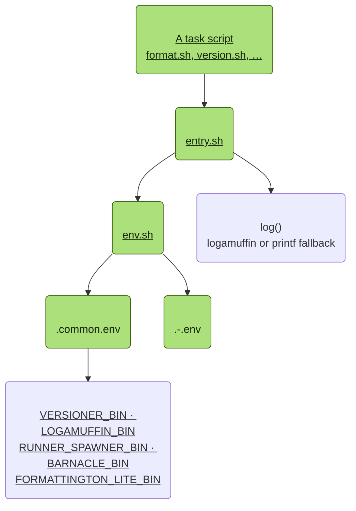

# Repository script tooling (`scripts/`)

The `scripts/` directory carries the repository's build/release/docs tooling: an environment cascade the other scripts source, plus one entry point per task. Everything here is bash; nothing requires a global install beyond what each script documents.

Vernacular used in the headers (`log INFO`, `REPO_ROOT_DIR`, `VERSIONER_BIN`): read [entry.sh.md](entry.sh.md) first, then [env.sh.md](env.sh.md).

The embedded task scripts live in [`Embedded/`](../Embedded/) (`build.sh`, `clean.sh`, `detect.sh`, `flash.sh`, `run.sh`, `setup_ide.sh`, `test.sh`, `generate_web_hpp.sh`). The remaining AirFrame embedded scripts (`release.sh`, `release_source.sh`, hardware `test.py`) land when the corresponding functionality does; `scripts/.common.env` already carries the shared ESP32-S3 release payload lists. They share `Embedded/helpers.sh`, which sources `scripts/entry.sh` and adds the mode argument parsing, the `LOG_PIDS` bookkeeping, and the PlatformIO wrappers.

## The cascade (why the dotfiles exist)

- `scripts/entry.sh` — sources `scripts/env.sh` and defines `log()` (logamuffin, with a printf fallback), `LOG_LEVEL`/`LOG_LEVEL_NAME` normalisation, and `log_level_name()`. Sourced by the task scripts and by the tools' update scripts. See [entry.sh.md](entry.sh.md).
- `scripts/env.sh` — locates and sources the cascade below, then anchors the repository-relative `*_BIN` tool paths to the repository root. See [env.sh.md](env.sh.md).
- `scripts/.common.env`, `scripts/.<os>-<arch>.env` — the cascade proper. Hidden files, so barnacle does not render them as pages; [env.sh.md](env.sh.md) is their documentation. `.common.env` holds the platform-independent settings (repository identity, versioning, embedded script paths, the shared ESP32-S3 release payloads, `VENV`, `TOOLS_DIR=tools`, the `fordaj/*` upstream repos, versioner's `.versioner.json` settings, and the pinned `*_VERSION_DIR`s: versioner `v0.0.3.0.17`, logamuffin `v0.1.3.0.35`, runner-spawner `v0.0.1.2.16`, barnacle `v0.0.2.1.25`, formattington-lite `v0.0.3.0.67`). Each platform file (`windows-x86_64`, `macos-x86_64`) sets `PROJECT_PLATFORM`, the `*_BIN` paths, the venv-relative Python tool paths, and the host release payload. This cascade subsumes the old root-level `project.env` / `project.<platform>.env` cascade; see [env.sh.md](env.sh.md) for the merge notes.

## Task scripts

- [version.sh](version.sh.md) — print the repository version computed by versioner (`--format text|shell|json`, or `--write` to materialise `.version/Version.hpp`/`Version.txt`).
- [format.sh](format.sh.md) — format the repository in place with formattington.
- [spawn-runners.sh](spawn-runners.sh.md) — spawn self-hosted GitHub Actions runners for this repository.
- [docs.sh](docs.sh.md) — generate the documentation site with the bundled barnacle.
- [release.sh](release.sh.md) — compute the version, tag `HEAD`, push the tag, and create the GitHub release (version tracking only; see the caveat in [release.sh.md](release.sh.md)).
- [Embedded/build.sh](../Embedded/build.sh) and friends — build, flash, run, and test the host and ESP32-S3 targets (host, ESP32_S3, ESP32_S3_EMULATED).
- [entry.sh](entry.sh.md) / [env.sh](env.sh.md) — the sourced cascade and `log()` helper (not entry points).

## Related pages

- `tools/README.md` — the bundled helper binaries these scripts resolve (not rendered in the site)
- [../README.md](../README.md)
