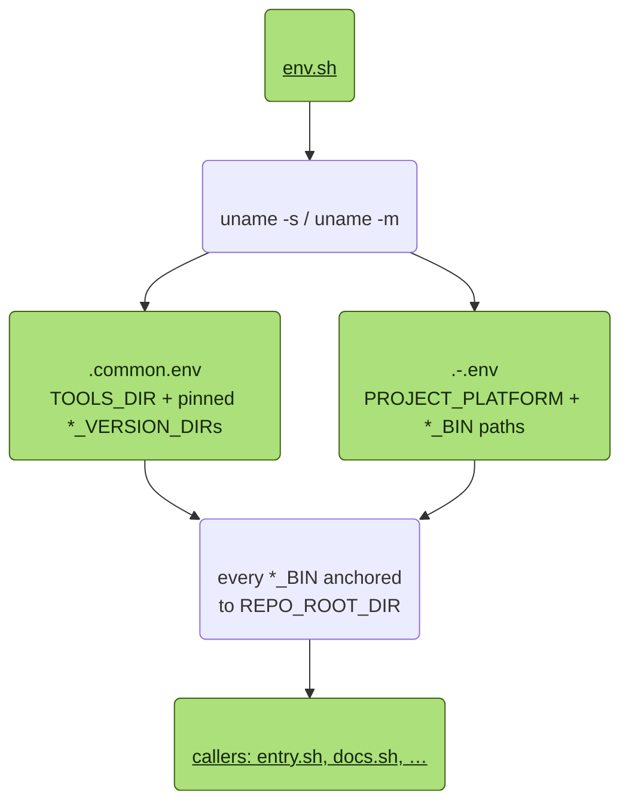

# The environment cascade (`scripts/env.sh` + the hidden `.*.env` files)

`scripts/env.sh` is the plumbing that makes the pinned helper tools resolvable from any script, in any working directory, on every supported platform. It is sourced — never executed — and it works from both bash and zsh.

## What it does

1. Locates the cascade files relative to itself (bash via `$BASH_SOURCE`, zsh via `$ZSH_VERSION`) so sourcing works from any cwd.
2. Brings in `.common.env`, then the platform file selected by `uname -s`/`uname -m` — for example `.windows-x86_64.env` or `.macos-x86_64.env`. Only `windows-x86_64` and `macos-x86_64` are supported; every other platform prints `Unsupported platform: <os> <arch>` and returns `1`. This matches the repository's supported host platforms.
3. **Anchors** every repository-relative tool path to the repository root (`REPO_ROOT_DIR`), leaving absolute paths untouched. After sourcing, `$VERSIONER_BIN`, `$LOGAMUFFIN_BIN`, `$RUNNER_SPAWNER_BIN`, `$BARNACLE_BIN`, `$FORMATTINGTON_LITE_BIN`, `$PIO_EXE`, `$ESPTOOL_EXE`, `$PYTHON_EXE`, and `$VENV` are absolute.
4. Sets `REPO_ROOT_DIR` for callers that need the repository root (for example [version.sh](version.sh.md) and the embedded task scripts).

Everything is exported with `set -a` while sourcing and un-exported at the end, so the cascade does not leak into the caller's environment beyond the intended variables.

## The hidden files

Hidden files are excluded from barnacle's default scan, so their contract is documented here:

- **`.common.env`** — the platform-independent settings:
  - Repository identity: `REPO_HOST=github.com`, `REPO_OWNER=fordaj`, `REPO_NAME=smart-string-lights`.
  - Versioning: `VERSION_DIR=.version` (version is computed by [version.sh](version.sh.md); `--write` materialises `.version/Version.hpp` and `.version/Version.txt`).
  - Embedded task-script paths (`BUILD_SH`, `RUN_SH`, `FLASH_SH`, …), `VENV=./.venv`, and the shared `ESP32_S3_*_RELEASE_FILES` payloads (used once `Embedded/release.sh` is ported over).
  - The bundled-tool pins (`TOOLS_DIR=tools`), the upstream `fordaj/*` repository slugs (`fordaj/Versioner`, `fordaj/logamuffin`, `fordaj/runner-spawner`, `fordaj/barnacle`, `fordaj/formattington`), versioner's release config (`VERSIONER_TAG_PATTERN="v[0-9]*"`, `VERSIONER_CONFIG_FILE=".versioner.json"`), and the pinned `*_VERSION_DIR`s:
    - `VERSIONER_VERSION_DIR=tools/versioner/v0.0.3.0.17`
    - `LOGAMUFFIN_VERSION_DIR=tools/logamuffin/v0.1.3.0.35`
    - `RUNNER_SPAWNER_VERSION_DIR=tools/runner-spawner/v0.0.1.2.16`
    - `BARNACLE_VERSION_DIR=tools/barnacle/v0.0.2.1.25`
    - `FORMATTINGTON_LITE_VERSION_DIR=tools/formattington-lite/v0.0.3.0.67`

  When bumping a pinned tool, this file names the version directory the platform files point into.

- **`.<platform>.env`** — one per supported platform (`windows-x86_64`, `macos-x86_64`). Sets `PROJECT_PLATFORM`, the `*_BIN` paths, the venv-relative Python tool paths (`PYTHON_EXE`, `PIO_EXE`, `ESPTOOL_EXE`, `VENV_ACTIVATE`).

- **`.common.env` merged history** — this cascade merges the repository's original root-level `project.env` + `project.<platform>.env` cascade into the RecipeServer layout: `.common.env` carries the repository identity, embedded script paths, ESP32-S3 release payloads, and versioning, plus the bundled-tool pins, and `.<platform>.env` carries the venv paths plus the per-platform `*_BIN` paths. The old files are gone; everything they defined lives here.

## Related pages

- [entry.sh.md](entry.sh.md) — the entry point most scripts source (it loads this file and defines `log()`)
- [version.sh.md](version.sh.md) — the version printer that resolves `VERSIONER_BIN` through this cascade
- [docs.sh.md](docs.sh.md) — the docs generator that resolves `BARNACLE_BIN` through this cascade
- `tools/README.md` — the bundles selected by the `*_BIN` variables (not rendered in the site)
